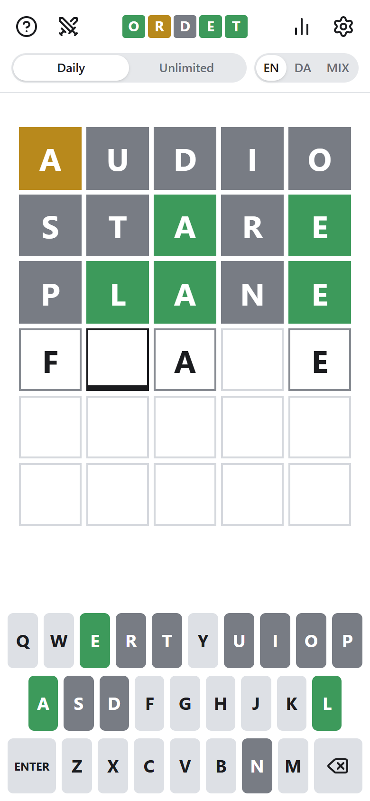
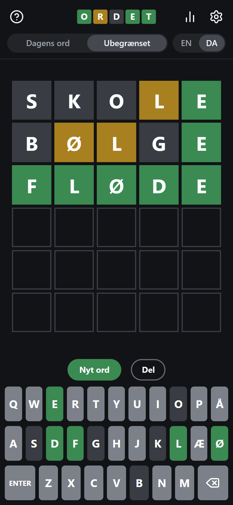
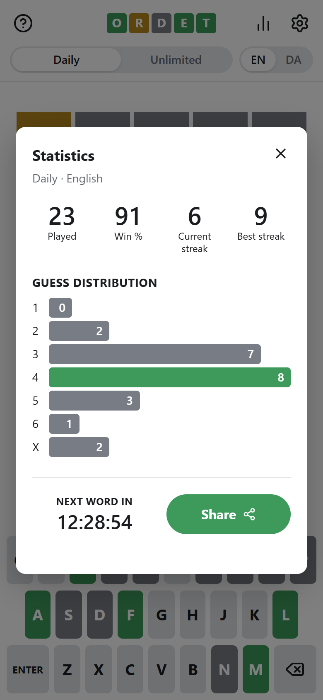
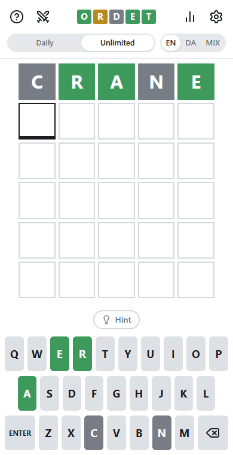

<div align="center">

# Ordet

**A daily word game in English and Danish.** Guess the five-letter word in six tries.

[**Play at ordet.bekirsaliv.dk**](https://ordet.bekirsaliv.dk) · [Spil på dansk](https://ordet.bekirsaliv.dk/?lang=da)

[](https://github.com/souliN02/ordet/actions/workflows/ci.yml)





</div>

## How to play

Every guess has to be a real five-letter word. After each one, the tiles show how close you were: **green** is the right letter in the right spot, **yellow** is in the word but somewhere else, and **gray** isn't in the word. You have six tries.

## Features

**Two modes, two languages.** Each language and mode keeps its own game, streak and statistics, so the Danish daily doesn't break the English streak.

| | English | Danish |
| --- | --- | --- |
| **Daily** | The same word as that day's NYT Wordle, so you can compare with friends who play it | Ordet's own word of the day, the same for everyone |
| **Unlimited** | A new word whenever you finish one | The same, in Danish |

The daily word changes at the player's own midnight.

**Type in any order.** Tap a tile, or use the arrow keys, Home and End, to move the cursor. The letters you already know can go in their spots first, and the next letters fill the gaps around them.

<p align="center">
  
</p>

**Real Danish.** The answers are common Danish words, and every inflected form in Den Danske Ordbog counts as a guess, so *huset* and *bøger* work even though they're never the answer. The Danish keyboard has Æ, Ø and Å where a Danish keyboard has them.

**And the rest:**

- Hard mode: every revealed hint has to be used in the next guesses.
- Statistics per language and mode: games played, win rate, current and best streak, how many guesses each win took, and how many games weren't solved.
- Sharing without spoilers: the result as emoji squares, through the share sheet on phones and the clipboard elsewhere.
- Dark and high contrast themes. Dark follows the system setting until you pick one, and high contrast swaps green and yellow for orange and blue.
- The physical keyboard works, every guess is read out to screen readers, the dialogs keep focus where it belongs, and animations stop when the system asks for reduced motion.
- `?lang=da` and `?mode=unlimited` open the game in that language or mode.

## How it works

```
app/
  page.tsx            the game (a client component; everything depends on the player's browser)
  api/daily/          GET /api/daily?date=YYYY-MM-DD: the English daily word
components/           Game (state and flow), Board, Keyboard, Header, the three dialogs
data/
  ui.ts               all interface text, English and Danish, typed so Danish can't miss a key
  words/              the word lists (see scripts/words/README.md)
lib/                  pure logic, unit tested: evaluation, hard mode, the row being typed,
                      daily schedule, statistics, sharing, saved state, word loading
scripts/
  words/              how the word lists were built, and what was left out by hand
  screenshots.py      makes the pictures in docs/
```

A few decisions worth knowing about:

- **Evaluation is two passes.** Greens first, then yellows from the letters left over, so a repeated letter is only marked as often as the answer has it (`lib/game.ts`).
- **The row being typed is five slots and a cursor** (`lib/input.ts`). A letter fills the cursor's slot and the cursor jumps to the next gap, wrapping back to an earlier one. Once the row is full the cursor parks past the end, so typing straight through behaves exactly like a plain left-to-right game.
- **The English daily word comes from the server.** The Times has no public API, only the JSON its own game loads, and the browser can't read it (CORS). `/api/daily` fetches it for the player's local date, caches it for a day, and falls back to Ordet's own schedule if the request fails. It only answers for dates within a day of today, so it can't be used to look ahead.
- **The word lists are curated.** The Danish answers are the most frequent five-letter headwords in DSL's frequency list, and the English ones are common base forms from ENABLE. Both were read through by hand to take out names, slurs and obscure words: 2,040 English and 1,299 Danish answers, with 11,834 and 8,155 accepted guesses.
- **Saved state is validated.** Progress lives in `localStorage`, which the player controls, so it's parsed field by field and anything malformed is dropped (`lib/save.ts`).
- **Word lists load on demand.** Each language is its own chunk, fetched the first time that language is played.

## Tech

Next.js 15 (App Router), React 19, TypeScript (strict), Tailwind CSS v4, Vitest and GitHub Actions, hosted on Vercel.

## Running it

The project uses [pnpm](https://pnpm.io). With Node.js 22+, `corepack enable` sets up the pinned version.

```bash
pnpm install
pnpm dev             # http://localhost:3000
```

```bash
pnpm lint
pnpm typecheck
pnpm test
pnpm build
```

CI runs all four on every push and pull request. No environment variables are needed.

To redo the screenshots after a design change, start a production build (`pnpm build && pnpm start`) and run `python scripts/screenshots.py` (it needs `pip install playwright pillow` and Microsoft Edge).

## Credits

The Danish word lists are based on [Den Danske Ordbog](https://ordnet.dk/ddo)'s full-form list and the frequency list from [Det Danske Sprog- og Litteraturselskab (DSL)](https://dsl.dk), used under DSL's terms for open language resources. The English lists come from ENABLE (public domain) and [Wordnik's word list](https://github.com/wordnik/wordlist) (MIT). Details are in [scripts/words/README.md](scripts/words/README.md).

Wordle is a trademark of The New York Times Company. Ordet is an independent game and isn't affiliated with or endorsed by the Times or DSL.

The code is available under the [MIT License](LICENSE). The word lists in `data/words` keep their sources' terms.
